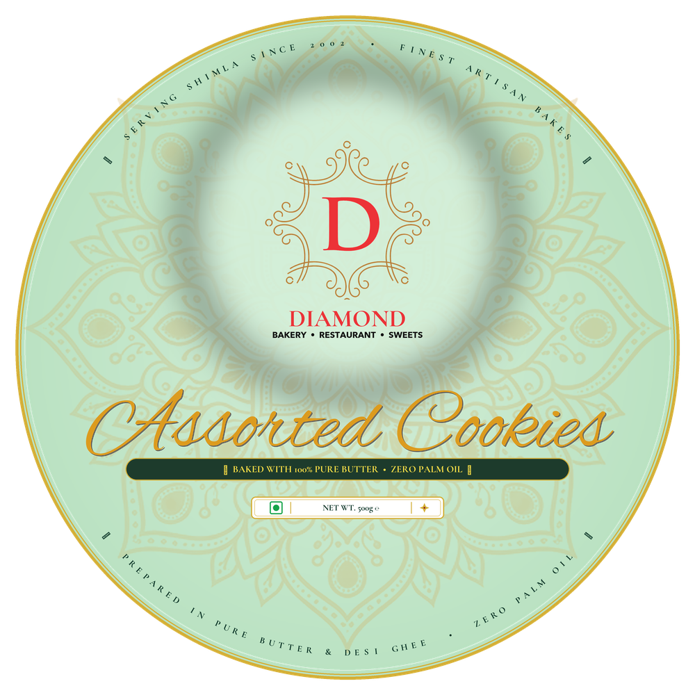
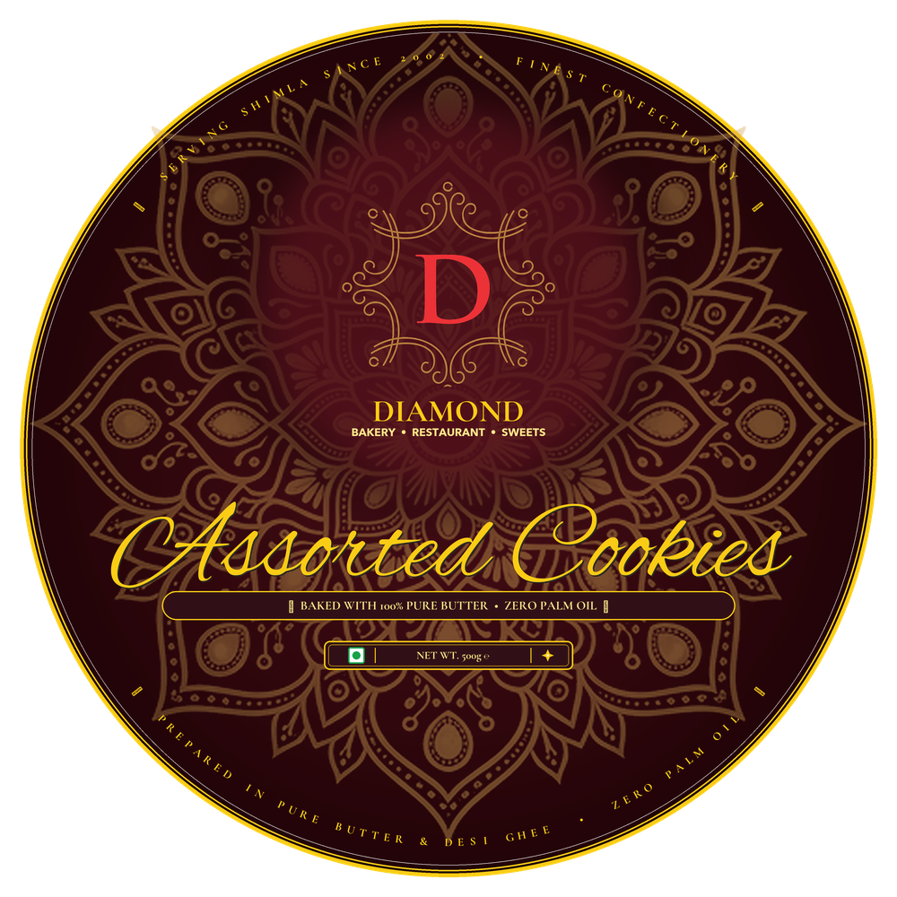

# 💎 Diamond Bakery • 6-Inch Round Cookie Tin Packaging Studio

> **Ultra-Luxury, 600 DPI Print-Ready Packaging Design & Imposition Suite for Steel Dabbas (Tin Containers).**  
> *Crafted for Diamond Bakery • Restaurant • Sweets (Serving The Mall, Shimla Since 2002 — Srijan Bhog Companies Pvt. Ltd.).*

[](https://diamondrestaurants.com)
[-D4AF37?style=for-the-badge&logo=target)](https://github.com/ajaynxt)
[-0A3326?style=for-the-badge)](https://github.com/ajaynxt)
[](https://diamondrestaurants.com)
[](https://github.com/ajaynxt)

---

## 🏔️ Brand Heritage & Design Philosophy (Diamond Bakery, Shimla)

Established in **2002 in Shimla, Himachal Pradesh** on the historic Mall Road, **Diamond Bakery • Restaurant • Sweets** (part of *Srijan Bhog Companies Pvt. Ltd.*) represents over two decades of confectionery excellence.

Key Brand Pillars integrated into the packaging:
- **Serving Shimla Since 2002**: Two decades of royal baking heritage.
- **Pure Vegetarian & Clean Ingredients**: 100% Pure Butter and Desi Ghee preparation — **Strictly Zero Palm Oil & Zero Dalda**.
- **Melodi Confectionery Tin Elegance**: Inspired by vintage luxury European and Turkish confectionery tins (e.g., Melodi 1957), focusing on regal concentric gold filigree, authentic Cormorant serif brand typography, and fluid Alex Brush script without requiring cookie photos on the tin lid.

---

## 🌟 Visual Showcase: 2 Master Packaging Designs

| 🌿 Design 1: Tiffany Mint & Emerald Luxury | 🍷 Design 2: Royal Velvet Maroon & 24K Gold |
| :---: | :---: |
|  |  |
| **Pastel Mint Ground • Deep Forest Emerald Text • 24K Gold Filigree** | **Deep Velvet Maroon Ground • 24K Liquid Gold Foil • Silk Ivory Text** |
| *100% Crystal-Clear Readability • Modern Luxury Bakery* | *Imperial Shahi Heritage • Specular Gold Reflection* |

---

## 📐 Packaging Production Specifications

| Specification | Master Value | Production Notes |
| :--- | :--- | :--- |
| **Physical Container** | 6-Inch Round Steel Dabba (Tin Lid) | Standard Indian Confectionery Container |
| **Physical Diameter** | 6.00 Inches / 152.4 mm | Radius = 3.00 Inches / 76.2 mm |
| **Canvas Dimensions** | 3600 × 3600 Pixels | Square bounding box containing circle |
| **Print Resolution** | 600 DPI Ultra High Definition | Zero pixelation at commercial offset/digital print |
| **Color Space** | CMYK / RGB High Gamut with 24K Gold Emulation | Specular metallic foil simulation |
| **Top & Bottom Arcs** | Symmetrical Radius = 530 px (Mirror Distance) | Follows outer rim contour (56px from outer edge) |
| **Center Alignment** | Concentric 360° Symmetry (`cx=600, cy=600`) | Mandala and logo centered on rotational axis |
| **Regulatory Compliance** | FSSAI Pure Veg Green Square Emblem | Authentic Indian Packaging Standard |

---

## ✨ Studio Features & Capabilities

### 1. 🎨 Full Element Color Control Center
- **Granular Customization**: Change the color of *every single layer* independently (Brand Name, Subtitle, Product Title, Top Arc, Bottom Arc, Tagline Text, Ribbon Fill, Net Weight Plaque, Mandala, and Outer Rims).
- **Instant High-Visibility Presets**: 1-click apply for **Mint & Emerald Luxury** or **Royal Velvet Maroon & 24K Gold**.

### 2. 📏 Granular Size Sliders (Badi / Choti Controls)
- Independent sliders for:
  - Top Arc Radius & Font Size
  - Logo Crest Scale (60% to 145%)
  - Brand "DIAMOND" Font Size (34px to 72px)
  - Subtitle Font Size (10px to 24px)
  - Product Title "Assorted Cookies" Font Size (70px to 185px)
  - Tagline Font Size & Ribbon Bar Width (550px to 920px)
  - Net Wt Plaque Scale & Text Size
  - Bottom Arc Radius & Font Size
  - Mandala Scale (80% to 150%) & Watermark Opacity (10% to 100%)

### 3. 👑 Authentic Brand Typography
- **DIAMOND**: Rendered in classical **Cormorant Garamond** (weight 700, tracking 0.08em), perfectly matching the original brand logo serifs and flared trumpet terminals.
- **Assorted Cookies**: Rendered in fluid, luxury **Alex Brush** cursive script with natural drop shadow for high contrast.
- **BAKERY • RESTAURANT • SWEETS**: Clean geometric uppercase sans-serif in bold weight.

### 4. 📄 A4 White Page Imposition & Print Engine
- **Standard A4 Paper Setup (210 × 297 mm)**:
  - **1 Label per A4**: 100% True 6-inch scale (152.4 mm) centered with 4-corner L-cut marks and circular die-cut guide.
  - **2 Labels per A4**: Stacked 142 mm labels.
  - **4 Labels per A4**: 2×2 sticker sheet grid (96 mm each).
  - **6 Labels per A4**: 2×3 tin decal stickers (80 mm each).
- **1-Click Print (`Ctrl+P` / `⌘P`)**: Uses dedicated `@media print` CSS so only the white A4 page prints at 100% scale without browser margins.
- **1-Click Download A4 (300 DPI)**: Exports a 2480 × 3508 px print-ready sheet.

### 5. 🌸 17 Royal Mandalas Library
- Includes 17 concentric vector mandalas:
  - `original` (Gold Floral Artwork), `taj` (Mughal Palace Jaali), `bloom` (Sacred Chrysanthemum), `lotus` (16-Petal Shahi Lotus), `starburst` (24-Ray Medallion), `victorian` (Baroque Lace), `arabesque` (8-Star Geometric), `chakra` (Solar Wheel), `moroccan` (Alhambra Vault), `paisley` (Royal Kalka Ambi), `diamond_gem` (Faceted Geometry), `sunburst_luxe` (48 Multi-Tier Rays), `jaipur_royal` (Hawa Mahal Arch), `rose_window` (Cathedral Rosette), `filigree` (French Gold Wire), `mandir_jaali` (Temple Kalash), `imperial_crown` (Shahi Finials).

---

## 🚀 Quick Start / How to Run

### Method 1: Interactive Studio (No Installation Required)
Simply double-click or open [`cookie_tin_preview.html`](cookie_tin_preview.html) in any modern web browser (Chrome, Safari, Edge, Firefox).

```bash
# On macOS
open cookie_tin_preview.html
```

### Method 2: Render Ultra High-Res 600 DPI Master PNGs
To regenerate the 3600 × 3600 px master print files using Python:

```bash
python3 render_ultra_high_res.py
```

Generated Master Files:
- `diamond_cookies_mint_luxury_600dpi.png` (~4.0 MB)
- `diamond_cookies_maroon_gold_600dpi.png` (~4.6 MB)

---

## 🖨️ Commercial Print Production Guidelines
1. **Paper Stock**: 120–170 GSM Semi-Gloss Adhesive Sticker Paper or Metallic Gold Foil Decal Vinyl.
2. **Die-Cut / Punching**: Circular die-punch at exact 6.00-inch diameter (152.4 mm).
3. **Finish Recommendation**: Soft-touch matte lamination with Spot UV gloss and embossed 24K gold hot-foil stamping on the crest and product title.

---

## 📜 License & Ownership
Copyright © 2026 **Diamond Bakery • Restaurant • Sweets**. All Rights Reserved.  
Designed and engineered for commercial packaging production.
